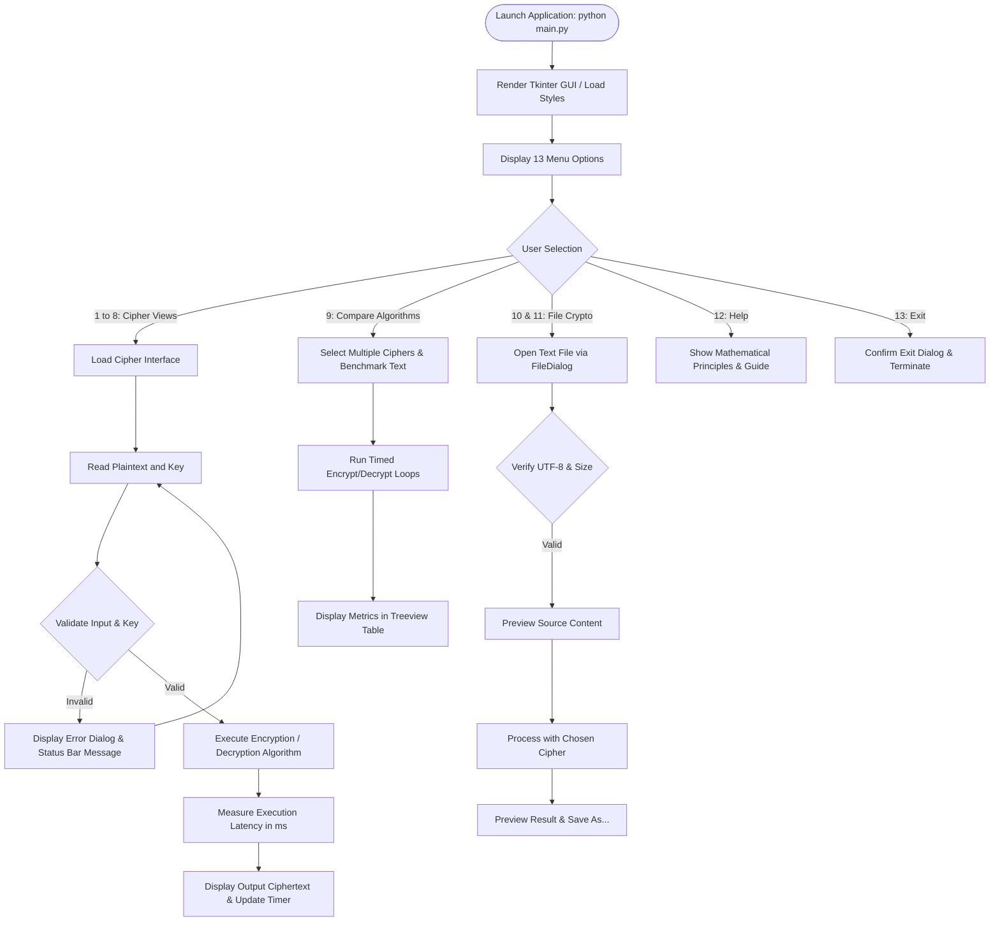

# DESIGN AND DEVELOPMENT OF A CLASSICAL CRYPTOGRAPHY TOOLKIT
## Final Year Engineering Mini-Project Report (2026–27)

---

### TITLE PAGE

**PROJECT TITLE:** Design and Development of a Classical Cryptography Toolkit  
**COURSE:** Network Security  
**CLASS:** Final Year (ECM) 2026–27  
**ACADEMIC YEAR:** 2026–2027  

**PROJECT TEAM MEMBERS (Placeholders):**
- Student Name 1: `[STUDENT_NAME_1]` | Roll No: `[ROLL_NO_1]` | Batch: `[BATCH_1]`
- Student Name 2: `[STUDENT_NAME_2]` | Roll No: `[ROLL_NO_2]` | Batch: `[BATCH_2]`
- Student Name 3: `[STUDENT_NAME_3]` | Roll No: `[ROLL_NO_3]` | Batch: `[BATCH_3]`

**PROJECT GUIDE:**  
- Guide Name: `[GUIDE_NAME]`, Department of Electronics and Computer Engineering (ECM)  

**INSTITUTION:**  
- Department of Electronics and Computer Engineering  
- `[COLLEGE_NAME_PLACEHOLDER]`  
- `[UNIVERSITY_AFFILIATION_PLACEHOLDER]`  

---

## 1. OBJECTIVES

The primary objectives of this Network Security mini-project are:
1. **Algorithmic Correctness:** To implement mathematically rigorous, reversible encryption and decryption routines for eight foundational classical ciphers spanning both substitution and transposition categories:
   - Caesar Cipher
   - Monoalphabetic Substitution Cipher
   - Playfair Cipher
   - Hill Cipher (2x2 and 3x3 matrices)
   - Vigenère Polyalphabetic Cipher
   - One-Time Pad (Vernam Cipher)
   - Rail Fence Cipher
   - Columnar Transposition Cipher
2. **Key Validation & Integrity:** To enforce robust input validation, preventing invalid matrix determinants in Hill Cipher ($\gcd(\det(K), 26) \neq 1$), verifying Playfair digraph rules, validating substitution permutations, and ensuring length parity in One-Time Pad ciphers.
3. **Interactive Graphical User Interface (GUI):** To build a clean, accessible, and responsive Tkinter GUI featuring 13 distinct navigation options divided cleanly into Substitution Ciphers, Transposition Ciphers, and Analysis Tools.
4. **Comparative Analysis Engine:** To provide a multi-cipher benchmarking module that measures encryption/decryption execution times (in milliseconds) and output length expansion, instilling the cybersecurity principle that execution speed does not imply cryptographic security.
5. **Safe File Cryptography:** To implement secure UTF-8 file operations supporting file loading, live previewing, cipher processing, and separate destination saving without overwriting original input files.
6. **Pedagogical Clarity:** To document the historical origins, mathematical formulations, cryptanalytic weaknesses, and modern successors for each cipher.

---

## 2. PROBLEM STATEMENT

In academic curricula for Network Security and Information Assurance, students often study classical ciphers purely through theoretical formulas on paper or fragmented, incomplete code snippets. Common issues include:
- Incomplete implementations that fail on spaces, punctuation, mixed case, or irregular message lengths.
- Lack of mathematical rigor, such as neglecting modular invertibility checks in Hill Ciphers (leading to uncaught runtime division-by-zero or non-invertible modular exceptions).
- Misunderstandings regarding the One-Time Pad (OTP), where pseudo-random numbers or key reuse are erroneously assumed to provide Shannon's perfect secrecy.
- Absence of an integrated desktop environment where students can visualize cipher behavior, inspect intermediate steps, compare execution latency, and test real files.

There is a compelling need for a unified, standalone, and mathematically validated Classical Cryptography Toolkit that runs natively on Windows desktop systems without requiring external cloud APIs, databases, or costly third-party software.

---

## 3. SOFTWARE REQUIREMENTS

### 3.1 Hardware Environment
- **Processor:** Intel Core i3 / AMD Ryzen 3 or higher (x86_64)
- **RAM:** Minimum 2 GB (4 GB recommended)
- **Storage:** 50 MB free disk space

### 3.2 Software Environment
- **Operating System:** Windows 10 / Windows 11 (64-bit)
- **Core Runtime:** Python 3.10 to 3.14 (Verified on Python 3.14.3)
- **GUI Framework:** Python standard library `tkinter` (Native desktop GUI)
- **Testing Framework:** `pytest` (v9.1.1) and Python built-in `unittest`
- **Optional Document Tools:** `reportlab` (PDF generation), `python-pptx` (PowerPoint generation)
- **Development Tools:** Visual Studio Code / PyCharm / Windows Terminal

---

## 4. SYSTEM DESIGN

### 4.1 System Architecture

The toolkit follows a strictly decoupled, modular architectural model:

```
+-------------------------------------------------------------------+
|                        PRESENTATION LAYER                         |
|   Tkinter GUI (gui.py)  <--->  Console CLI Mode (main.py --cli)   |
+-------------------------------------------------------------------+
                                  |
                                  v
+-------------------------------------------------------------------+
|                      VALIDATION & DISPATCH LAYER                  |
|          validators.py  |  file_operations.py  |  comparison.py   |
+-------------------------------------------------------------------+
                                  |
         +------------------------+------------------------+
         |                                                 |
         v                                                 v
+-----------------------------+               +-----------------------------+
|    SUBSTITUTION MODULES     |               |    TRANSPOSITION MODULES    |
| - caesar.py                 |               | - rail_fence.py             |
| - monoalphabetic.py         |               | - columnar_transposition.py |
| - playfair.py               |               +-----------------------------+
| - hill.py                   |
| - vigenere.py               |
| - one_time_pad.py           |
+-----------------------------+
```

### 4.2 System Flowchart (Mermaid Diagram)



---

## 5. ALGORITHMS

### 5.1 Caesar Cipher
- **Principle:** Monoalphabetic shift cipher dating to Julius Caesar (circa 58 BC). Shifts each letter in the alphabet by a fixed integer key $k \in [0, 25]$.
- **Mathematical Formula:**
  $$\text{Encryption: } C_i = (P_i + k) \pmod{26}$$
  $$\text{Decryption: } P_i = (C_i - k + 26) \pmod{26}$$
- **Key Requirements:** Integer shift value. Normalized via modulo 26.
- **Handling:** Preserves character case. Preserves spaces, punctuation, digits, and special symbols unchanged.
- **Limitations:** Only 25 non-trivial keys; completely vulnerable to brute force search and single-letter frequency analysis.

### 5.2 Monoalphabetic Substitution Cipher
- **Principle:** Replaces each letter in the 26-letter standard alphabet with a distinct corresponding letter from a scrambled 26-letter permutation alphabet.
- **Mathematical Formula:**
  $$\text{Encryption: } C_i = f(P_i) \quad \text{where } f: \Sigma \to \Sigma \text{ is a bijection.}$$
  $$\text{Decryption: } P_i = f^{-1}(C_i)$$
- **Key Requirements:** Either a 26-letter string containing every letter from A to Z exactly once, or a keyword expanded systematically with remaining unused letters.
- **Limitations:** Key space is $26! \approx 4.03 \times 10^{26}$, but letter frequency distribution is directly preserved, rendering it vulnerable to frequency analysis (e.g., matching common English letters: E, T, A, O, I, N, S, H, R, D, L, U).

### 5.3 Playfair Cipher
- **Principle:** Digraphic substitution cipher created by Charles Wheatstone in 1854. Operates on 2-letter blocks (digraphs) across a $5 \times 5$ matrix of 25 letters (combining 'I' and 'J').
- **Algorithm Steps:**
  1. Construct $5 \times 5$ matrix using unique letters of the keyword, followed by remaining alphabet letters omitting 'J'.
  2. Filter plaintext to uppercase; replace 'J' with 'I'.
  3. Divide into pairs. If both letters in a pair are identical, insert filler 'X' (or 'Q' if the repeated letter is 'X').
  4. If length is odd, pad final letter with 'X'.
  5. Apply transformation rules:
     - **Same Row:** Replace each letter with letter to its right $(\text{col} + 1) \pmod 5$.
     - **Same Column:** Replace each letter with letter below it $(\text{row} + 1) \pmod 5$.
     - **Rectangle:** Replace with letter in same row and other letter's column.
  6. Decryption reverses row and column shifts $((\text{col} - 1 + 5) \pmod 5, (\text{row} - 1 + 5) \pmod 5)$.
- **Limitations:** Vulnerable to digraph frequency analysis (e.g., identifying common digraphs such as TH, HE, IN, ER).

### 5.4 Hill Cipher
- **Principle:** Invented by Lester S. Hill in 1929, the Hill Cipher utilizes modular linear algebra. Plaintext blocks of size $m$ are transformed via an $m \times m$ matrix $K$ modulo 26.
- **Mathematical Formula:**
  $$\text{Encryption: } \mathbf{C} = (\mathbf{P} \cdot K) \pmod{26}$$
  $$\text{Decryption: } \mathbf{P} = (\mathbf{C} \cdot K^{-1}) \pmod{26}$$
- **Strict Invertibility Requirement:**
  The determinant $d = \det(K) \pmod{26}$ must satisfy:
  $$\gcd(d, 26) = 1 \quad \text{and} \quad d \neq 0$$
  Since $26 = 2 \times 13$, $\det(K)$ must not be divisible by 2 or 13.
  The modular inverse matrix is given by:
  $$K^{-1} = (d^{-1} \cdot \text{adj}(K)) \pmod{26}$$
- **Limitations:** Linear system vulnerable to Known-Plaintext Attacks (KPA). An attacker with $m$ plaintext-ciphertext pairs can solve for $K$ directly via Gaussian elimination modulo 26.

### 5.5 Vigenère Cipher
- **Principle:** Polyalphabetic substitution cipher described by Giovan Battista Bellaso (1553). Shifts letters using a repeating keyword stream, flattening single-letter frequency spikes.
- **Mathematical Formula:**
  $$\text{Encryption: } C_i = (P_i + K_{j \pmod L}) \pmod{26}$$
  $$\text{Decryption: } P_i = (C_i - K_{j \pmod L} + 26) \pmod{26}$$
  where $j$ only advances when an alphabetic character is encrypted.
- **Limitations:** Vulnerable to Kasiski examination (finding distances between repeated ciphertext n-grams to factor keyword length $L$) followed by Friedman's Index of Coincidence test.

### 5.6 One-Time Pad (Vernam Cipher)
- **Principle:** Patented by Gilbert Vernam in 1917 and proven unbreakable by Claude Shannon in 1949. Offers Information-Theoretic Security (perfect secrecy) where $H(M|C) = H(M)$.
- **Mandatory Security Conditions:**
  1. Key must be generated uniformly at random with high entropy (CSPRNG via Python `secrets`).
  2. Key length must strictly equal the message length.
  3. Key must be kept strictly secret.
  4. Key must NEVER be reused.
- **Two-Time Pad Vulnerability:**
  If key $K$ is used to encrypt $P_1$ and $P_2$:
  $$C_1 - C_2 \equiv (P_1 + K) - (P_2 + K) \equiv P_1 - P_2 \pmod{26}$$
  The key cancels out, enabling crib dragging and statistical language recovery.

### 5.7 Rail Fence Cipher
- **Principle:** Classical transposition cipher that writes characters in a diagonal zigzag across $k$ horizontal rails, then reads them row-by-row.
- **Cycle Length:** $T = 2(k - 1)$ for $k \ge 2$.
- **Position Formula:**
  $$\text{rail}(i) = \begin{cases} i \pmod T & \text{if } (i \pmod T) < k \\ T - (i \pmod T) & \text{otherwise} \end{cases}$$
- **Decryption:** Reconstructs the exact coordinate grid by marking the zigzag trajectory, filling the markers row-by-row with ciphertext, and reading off diagonally.
- **Limitations:** Small key space ($k \in [2, N-1]$); letter frequency distribution remains identical to the plaintext.

### 5.8 Columnar Transposition Cipher
- **Principle:** Plaintext is written into a grid of width $W = \text{len}(\text{key})$ row-by-row, and read out column-by-column in the alphabetical order of the characters in the key.
- **Irregular Grid Support:** If $N \pmod W \neq 0$, the first $(N \pmod W)$ columns contain $\lceil N/W \rceil$ characters, while remaining columns contain $\lfloor N/W \rfloor$ characters. Our algorithm calculates individual column lengths dynamically, ensuring exact round-trip reconstruction without mandatory padding.
- **Limitations:** Vulnerable to anagramming and bigram reconstruction techniques.

---

## 6. PROGRAM MODULES

| Module Name | File Path | Primary Responsibilities |
| :--- | :--- | :--- |
| **Validators** | `src/validators.py` | Validates text strings, integer shifts, 26-letter substitution alphabets, Playfair keywords, Hill matrix invertibility modulo 26, OTP length parity, rail depths, and columnar permutations. |
| **Caesar Module** | `src/caesar.py` | Encrypts and decrypts with case preservation, non-alpha preservation, and verified test vector handling. |
| **Monoalphabetic**| `src/monoalphabetic.py` | Handles 1-to-1 letter mapping, keyword-expanded alphabets, and mapping inspection. |
| **Playfair Module**| `src/playfair.py` | Generates $5 \times 5$ matrix (J=I), prepares digraph pairs, inserts filler 'X'/'Q', and implements row/column/rectangle transformation rules. |
| **Hill Module** | `src/hill.py` | Implements 2x2 and 3x3 matrix multiplication, determinant evaluation, adjugate matrix calculation, and modular matrix inversion modulo 26. |
| **Vigenère Module**| `src/vigenere.py` | Implements polyalphabetic shift, keystream alignment over alphabetic letters, and punctuation preservation. |
| **One-Time Pad** | `src/one_time_pad.py` | Generates CSPRNG keys via `secrets`, validates key length equality, and executes classical modulo-26 OTP. |
| **Rail Fence** | `src/rail_fence.py` | Implements zigzag diagonal placement and reversible matrix grid reconstruction. |
| **Columnar Trans.**| `src/columnar_transposition.py` | Implements row-by-column grid writing, column ranking, and exact irregular grid reconstruction. |
| **Comparison** | `src/comparison.py` | Benchmarks multiple ciphers with execution timing (ms), output expansion, and round-trip verification. |
| **File Operations**| `src/file_operations.py` | Manages safe UTF-8 reading, size validation, preview generation, and non-destructive saving. |
| **GUI Module** | `src/gui.py` | Tkinter graphical user interface with 13 categorized options, real-time status bar, and execution timer. |
| **Application Root**| `main.py` | Application entry point supporting GUI launch, interactive CLI mode, and automated demonstration. |

---

## 7. SAMPLE INPUTS AND OUTPUTS

### 7.1 Verified Caesar Cipher Demonstration
- **Plaintext:** `NETWORK SECURITY`
- **Key:** `5`
- **Ciphertext:** `SJYBTWP XJHZWNYD`
- **Decrypted:** `NETWORK SECURITY`
- **Verification Note:** Standard English alphabet shift maps `NETWORK` to `SJYBTWP` and `SECURITY` to `XJHZWNYD`. The toolkit corrects the common typographical error in problem statements that mistakenly formatted the ciphertext as `SJYBTW P XJHZWNYD`.

### 7.2 Monoalphabetic Substitution Sample
- **Plaintext:** `CLASSICAL CRYPTOGRAPHY`
- **Key:** `QWERTYUIOPASDFGHJKLZXCVBNM`
- **Ciphertext:** `ESQLLOEQS EKNHZGUKQHIN`
- **Decrypted:** `CLASSICAL CRYPTOGRAPHY`

### 7.3 Playfair Cipher Sample
- **Plaintext:** `INSTRUMENTS`
- **Keyword:** `MONARCHY`
- **Digraphs Prepared:** `IN ST RU ME NT SX` (padded final single letter with 'X')
- **Ciphertext:** `GATLMZCLRQXA`
- **Decrypted:** `INSTRUMENTSX`

### 7.4 Hill Cipher Sample (2x2 Matrix)
- **Plaintext:** `HELP`
- **Key Matrix:** `3 3 2 5` ($\det = 9 \pmod{26}$, $\gcd(9, 26) = 1$)
- **Inverse Matrix:** `15 17 20 9`
- **Ciphertext:** `DPLE`
- **Decrypted:** `HELP`

### 7.5 Vigenère Cipher Sample
- **Plaintext:** `CRYPTOGRAPHY AND NETWORK SECURITY`
- **Keyword:** `SECURITY`
- **Ciphertext:** `UVAJKWZPSTJS RVW LWXYIIS LCUYTCKG`
- **Decrypted:** `CRYPTOGRAPHY AND NETWORK SECURITY`

### 7.6 Rail Fence Cipher Sample
- **Plaintext:** `DEFEND THE EAST WALL`
- **Key (Rails):** `3`
- **Ciphertext:** `DNHAWEEDTEES ALF  TL`
- **Decrypted:** `DEFEND THE EAST WALL`

### 7.7 Columnar Transposition Sample
- **Plaintext:** `WE ARE DISCOVERED FLEE AT ONCE`
- **Keyword:** `ZEBRA`
- **Ciphertext:** `RSRLTE DV  NE ODEOAIEFACWECEE `
- **Decrypted:** `WE ARE DISCOVERED FLEE AT ONCE`

---

## 8. TESTING AND TEST RESULTS

### 8.1 Automated Test Execution Summary
The test suite was executed using `pytest 9.1.1` under Python 3.14.3:
- **Total Test Cases:** 58
- **Passed:** 58 (100%)
- **Failed:** 0
- **Duration:** 0.25 seconds

### 8.2 Test Scope Coverage
1. **Normal Test Vectors:** Known-answer vectors for all 8 ciphers verified.
2. **Round-Trip Integrity:** Plaintext encrypted and decrypted matches original across all algorithms.
3. **Punctuation and Whitespace:** Spaces, digits, newlines, and symbols preserved.
4. **Edge Cases:** Empty inputs, single characters, repeated letters ('LL', 'XX'), odd-length strings, irregular transposition grids.
5. **Key Validation:**
   - Hill Cipher rejects singular matrices ($\det = 0$) and non-coprime determinants ($\gcd(\det, 26) \in \{2, 13\}$).
   - Playfair rejects non-alphabetic keys.
   - OTP rejects keys with length mismatches.
   - Rail Fence rejects depths $< 2$.
   - Columnar Transposition rejects invalid permutations.

---

## 9. RESULTS AND PERFORMANCE EVALUATION

### 9.1 Benchmark Results (Sample Input: 45 Characters)

| Cipher Name | Category | Input Length | Ciphertext Length | Encrypt Time (ms) | Decrypt Time (ms) | Round-Trip |
| :--- | :--- | :---: | :---: | :---: | :---: | :---: |
| **Caesar Cipher** | Substitution | 45 | 45 | 0.0190 | 0.0176 | Passed |
| **Monoalphabetic**| Substitution | 45 | 45 | 0.0359 | 0.0237 | Passed |
| **Playfair Cipher**| Substitution | 45 | 42 | 0.1386 | 0.0984 | Passed |
| **Hill Cipher** | Substitution | 45 | 42 | 0.1244 | 0.1805 | Passed |
| **Vigenère Cipher**| Substitution | 45 | 45 | 0.0393 | 0.0349 | Passed |
| **One-Time Pad** | Substitution | 45 | 45 | 0.0528 | 0.0440 | Passed |
| **Rail Fence** | Transposition | 45 | 45 | 0.0273 | 0.0424 | Passed |
| **Columnar Trans.**| Transposition| 45 | 45 | 0.0347 | 0.0377 | Passed |

### 9.2 Key Technical Takeaway
While simpler ciphers like Caesar and Rail Fence exhibit ultra-low latency ($< 0.03 \text{ ms}$), their microscopic keyspaces make them trivially broken. Conversely, One-Time Pad provides unconditional theoretical security when used properly, yet requires linear key exchange. Performance benchmarks clearly illustrate the fundamental tradeoff between computational efficiency, key management complexity, and cryptographic security.

---

## 10. APPLICATIONS

1. **Academic Instruction:** Serves as a hands-on laboratory toolkit for undergraduate courses in Network Security, Cryptography, and Computer Science.
2. **Demonstration of Cryptanalytic Principles:** Enables educators to visualize confusion and diffusion mechanisms, letter frequency distribution, and Kasiski examination concepts.
3. **Introductory Software Engineering:** Illustrates modular Python design, unit testing methodology, exception hierarchies, and Tkinter GUI architecture.

---

## 11. LIMITATIONS AND FUTURE SCOPE

### 11.1 Limitations
- Classical ciphers are strictly historical and pedagogical; they do not provide protection against modern computational cryptanalysis.
- The toolkit is optimized for UTF-8 textual messages and does not encrypt arbitrary binary files (.exe, .zip, .png).

### 11.2 Future Scope
1. **Cryptanalysis Tools:** Implement automated frequency analysis charts, Kasiski examination calculators, and Index of Coincidence estimators.
2. **Modern Cryptography Integration:** Expand the toolkit to include modern symmetric algorithms (AES, DES) and asymmetric algorithms (RSA, Diffie-Hellman) for direct pedagogical comparison.
3. **Web-Based Interface:** Package the core cryptographic modules into a responsive FastAPI / WebAssembly interactive web application.

---

## 12. LINKS AND REFERENCES

1. Stallings, William. *Cryptography and Network Security: Principles and Practice*. 8th Edition, Pearson, 2020.
2. Shannon, Claude E. "Communication Theory of Secrecy Systems." *Bell System Technical Journal*, vol. 28, no. 4, 1949, pp. 656–715.
3. Kahn, David. *The Codebreakers: The Comprehensive History of Secret Communication from Ancient Times to the Internet*. Scribner, 1996.
4. Python 3 Documentation - `secrets` Module: https://docs.python.org/3/library/secrets.html
5. Python 3 Documentation - `tkinter` Standard Library: https://docs.python.org/3/library/tkinter.html
